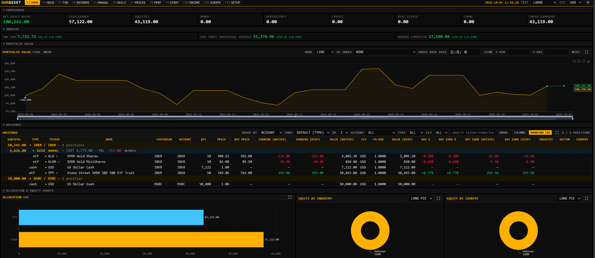
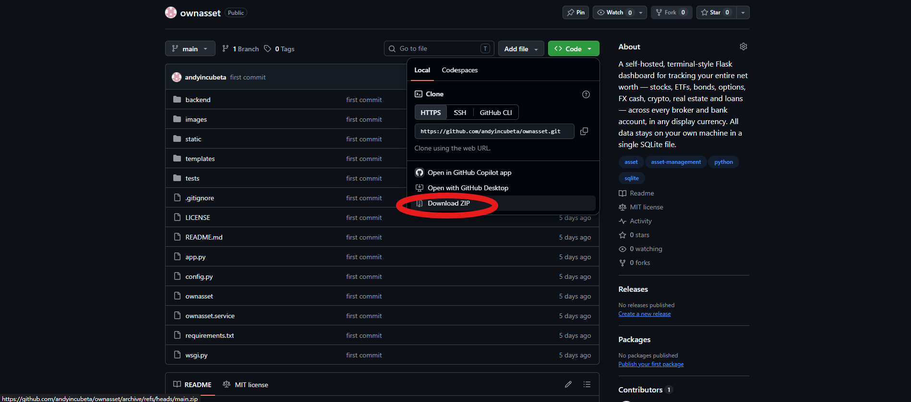

# OWNASSET

A self-hosted, terminal-style Flask dashboard for tracking your **entire** net worth — stocks, ETFs, bonds,
options, FX cash, crypto, real estate and loans — across every broker and bank account, in any
display currency. All data stays on your own machine in a single SQLite file.

---

## Quick Start (Windows, no coding needed)

1. **Install Python 3.10+** from <https://www.python.org/downloads/>. On the first installer screen,
   tick **"Add python.exe to PATH"**.
2. **Download OWNASSET** — on this GitHub page click the green **Code** button, then **Download ZIP**.

   

3. **Unzip it** — right-click the downloaded `ownasset-main.zip` > **Extract All...**, then open the
   extracted `ownasset-main` folder (the one that contains `run.bat`).
4. **Double-click `run.bat`.** The first run takes a minute or two while it sets up and installs
   everything. If Windows SmartScreen warns you, click **More info** > **Run anyway**.
5. **Use the app** — your browser opens <http://127.0.0.1:5089> automatically (if the page is blank,
   refresh it or type the address in yourself). Keep the black window open while you use the app;
   closing it stops OWNASSET.

Next time, just double-click `run.bat` again. Your data is kept in the `.db` folder inside
`ownasset-main` — don't delete it. Continue with [First steps in the app](#first-steps-in-the-app).
Comfortable with a terminal? See [Tutorial 1](#tutorial-1--run-locally-windows--macos--linux).

---

## Why OWNASSET

- **Your data, your box.** No cloud account, no subscription, no third-party aggregator. One SQLite
  file, with a verified backup copy made automatically every day.
- **One ledger, every account.** Every movement is a double-sided transaction (outflow party ->
  inflow party), so holdings, cash and cost basis are always derived from the same source of truth.
- **Live prices without API keys.** Talks to Yahoo Finance's REST endpoints directly (not the
  deprecated `yfinance` library) with batched quotes, automatic retries and rate-limit backoff.
- **Options that don't disappear.** Expired option contracts switch to the EOD Options Archive, so
  their full price history stays intact after Yahoo drops them.
- **Multi-currency done right.** Every value is converted through daily FX rates; switch the display
  currency (USD / HKD / CNY / ...) from the top bar at any time.
- **Honest performance numbers.** Modified Dietz monthly returns and time-weighted growth vs.
  S&P 500 / Dow / Nasdaq, with deposits ("disposable income") stripped out of the return.
- **Daily snapshots, automatically.** Every evening the whole portfolio is photographed; days missed
  while the app was off are rebuilt at the next start.
- **Broker CSV import.** Firstrade and Interactive Brokers (Flex Query) statements, with preview,
  unknown-ticker approval and import history. See
  [Tutorial 3](#tutorial-3--interactive-brokers-flex-query) for the IB query setup.
- **Strategy groups.** Tag trades into pair trades, option strategies or hedges and see the P&L of
  each strategy over time.
- **Keyboard first.** `F1`–`F12` jump straight to every page; dark/light theme and 7 text sizes.

---

## Pages and hotkeys

| Key   | Page    | What it does |
|-------|---------|--------------|
| `F1`  | HOME    | KPIs (NAV, cash, equities, bonds, derivatives, crypto, real estate, loans, gross exposure), allocation bar, NAV line, industry / country pies, index sparks, holdings table. Sections can be reordered and collapsed. |
| `F2`  | HOLD    | Full holdings table: filter, sort, group by account or strategy, choose columns, CSV export, per-position trade drill-down and asset info drawer. |
| `F3`  | TXN     | Enter transactions (any account or external party on either side, fees, templates) and import broker CSVs with preview. |
| `F4`  | RECORDS | Transaction blotter: filters, edit, split a transaction, bulk delete, assign to groups. |
| `F5`  | MANUAL  | Manual prices for things Yahoo can't price (property, private holdings, ...). |
| `F6`  | DAILY   | Daily end-of-day value matrix per asset with TOTAL column, chart vs. indices, CSV download. Today's row is live. |
| `F7`  | PRICES  | End-of-day price matrix for every asset ever held. |
| `F8`  | PERF    | Portfolio vs. indices (rebased to 100), stats strip, year x month returns and P&L table. |
| `F9`  | STRAT   | Per-strategy (transaction group) P&L over time, KPIs and the group's trades. |
| `F10` | INCOME  | Record disposable income (salary savings etc.) deposited into the portfolio. |
| `F11` | SCRAPE  | Status of the 6 background jobs, success/error chart, run log, "RUN NOW" buttons. Hover the `?` on each job card for an explanation. |
| `F12` | SETUP   | Display currency, time offset, theme, home layout, scraper intervals, backups, data purges, DB stats. |

> The F-keys replace the browser defaults (F5 reload, F11 fullscreen, F12 devtools) while the app
> is focused. Use `Ctrl+R` / `Ctrl+F5` to reload and `Ctrl+Shift+I` for devtools.

---

## Background jobs

All times are **UTC**. Intervals and times are editable under **SETUP > SCRAPER INTERVALS**.

| Job        | Default schedule      | What it fetches / stores |
|------------|-----------------------|--------------------------|
| `quotes`   | every 60 s            | One batched Yahoo request for all tracked assets + FX pairs -> latest price & previous close. Powers live values. |
| `intraday` | every 60 min, 60m bars| Last 7 days of intraday OHLC bars per asset. |
| `daily`    | 22:30                 | Daily OHLC history (full backfill on first run, then last 35 days), option-archive contracts, daily FX rates. |
| `info`     | 21:00                 | Yahoo quoteSummary profile per asset (fills name / industry / sector / country). |
| `snapshot` | 23:59                 | Quantity, price, FX and USD value of every holding for the day. |
| `backup`   | 00:30                 | Verified copy of the SQLite database to `.db/backups`, keeping the newest N. |

Every run is logged to the `scrape_log` table and `logs/scrape.log`, and shown on the SCRAPE page.

---

## Requirements

- Python **3.10+**
- Outbound HTTPS to `query1.finance.yahoo.com`, `fc.yahoo.com` and `api.onclickmedia.com`

Python packages (`requirements.txt`): `flask`, `apscheduler`, `requests`, `pytest`.
On a Linux server you also need `gunicorn`, plus `nginx` from the OS.

---

## Tutorial 1 — Run locally (Windows / macOS / Linux)

```bash
git clone https://github.com/andyincubeta/ownasset.git
cd ownasset

python -m venv .venv
# either in Windows PowerShell
.venv\Scripts\Activate.ps1
# or, for macOS / Linux Terminal
source .venv/bin/activate

pip install -r requirements.txt
python app.py
```

Open <http://127.0.0.1:5089>.

On first start the app creates:

- `.db/asset_dashboard.db` — the SQLite database (schema + seed currencies)
- `logs/app.log` and `logs/scrape.log` — rotating logs

Host and port are set in [config.py](config.py) (`HOST`, `PORT`).

### First steps in the app

1. **F12 SETUP** — pick your display currency, UTC offset and theme.
2. **F3 TXN** — create your accounts (inline "+" buttons), add assets by ticker (validated against
   Yahoo), then record your opening positions or import a broker CSV (IB users: set up the Flex
   Query first, see [Tutorial 3](#tutorial-3--interactive-brokers-flex-query)).
3. **F5 MANUAL** — enter prices for anything without a Yahoo ticker.
4. **F11 SCRAPE** — press **RUN NOW** on `daily` to backfill history immediately instead of waiting
   for the evening run.
5. **F1 HOME** — your portfolio is live.

### Tips

- **Add or remove holdings columns** — on **F2 HOLD** (or the holdings section on **F1 HOME**) press
  **COLUMNS**. Tick a column to show it, untick to hide it, use **▲ / ▼** to change its order, then
  **SAVE**. The choice is remembered and shared by both pages.
- **Refresh the daily chart** — the **F6 DAILY** chart and table are built from stored daily
  snapshots. After importing or editing past transactions, adding manual prices or backfilling
  history (SCRAPE > RUN NOW on `daily`), press **REBUILD SNAPSHOTS** on the DAILY page and confirm.
  Every daily row is recomputed from transactions × price history and the chart reloads.

---

## Tutorial 2 — Deploy on a Linux server (gunicorn + systemd + nginx)

The repo ships a systemd unit ([ownasset.service](ownasset.service)) and an nginx site
([ownasset](ownasset)). They assume user `user` and path `/home/user/ownasset`; adjust if yours
differ.

### 1. Install system packages

```bash
sudo apt update
sudo apt install -y python3 python3-venv python3-pip nginx git
```

### 2. Get the code and a virtualenv

```bash
cd /home/user
git clone https://github.com/andyincubeta/ownasset.git ownasset
cd ownasset
python3 -m venv .venv
.venv/bin/pip install -r requirements.txt gunicorn
```

Quick smoke test (Ctrl+C to stop):

```bash
.venv/bin/gunicorn --workers 1 --threads 4 --bind 127.0.0.1:5089 wsgi:app
```

### 3. systemd service

```bash
sudo cp ownasset.service /etc/systemd/system/ownasset.service
# edit User=, WorkingDirectory=, Environment=PATH and ExecStart= if your user/path differ
sudo systemctl daemon-reload
sudo systemctl enable --now ownasset
sudo systemctl status ownasset
```

The service starts gunicorn on a unix socket `ownasset.sock` in the project folder, group
`www-data` so nginx can reach it.

> **Keep `--workers 1`.** Each worker would start its own background scheduler and every job would
> run several times. Concurrency comes from `--threads`.

### 4. nginx reverse proxy

```bash
sudo cp ownasset /etc/nginx/sites-available/ownasset
# set server_name to your server's IP or domain
sudo ln -s /etc/nginx/sites-available/ownasset /etc/nginx/sites-enabled/
sudo rm -f /etc/nginx/sites-enabled/default   # optional, if it clashes on port 80
sudo nginx -t
sudo systemctl reload nginx
```

nginx (user `www-data`) must be able to traverse the home directory to reach the socket:

```bash
chmod o+x /home/user
```

Open `http://<server_name>/`.

### 5. Firewall

```bash
sudo ufw allow 'Nginx HTTP'
```

### 6. Security

OWNASSET has **no login**. Keep it on your LAN / VPN, or put authentication in front of it, e.g.
nginx basic auth:

```bash
sudo apt install -y apache2-utils
sudo htpasswd -c /etc/nginx/.htpasswd yourname
```

```nginx
location / {
    auth_basic "OWNASSET";
    auth_basic_user_file /etc/nginx/.htpasswd;
    include proxy_params;
    proxy_pass http://unix:/home/user/ownasset/ownasset.sock;
}
```

For anything reachable from the internet, also add HTTPS (e.g. `certbot --nginx`).

### 7. Update to a new version

```bash
cd /home/user/ownasset
git pull
.venv/bin/pip install -r requirements.txt
sudo systemctl restart ownasset
```

The database schema is created / migrated automatically at startup.

### 8. Logs

```bash
journalctl -u ownasset -f          # gunicorn / startup
tail -f logs/app.log logs/scrape.log
```

---

## Tutorial 3 — Interactive Brokers Flex Query

The IB importer reads an **Activity Flex Query** CSV (the classic activity-statement export is not
supported). The query below is the one the importer is built and tested against.

### 1. Create the query

In the IB Client Portal: **Performance & Reports > Flex Queries > Activity Flex Query > +**.
Name it e.g. `OWNASSET`.

### 2. Sections

In **every** section, tick `ClientAccountID` so it is the **first** column — the importer finds the
start of each section by a header row beginning with `ClientAccountID`. Field order otherwise
doesn't matter; extra fields are ignored.

**Imported sections**

| Section | Options | Fields |
|---------|---------|--------|
| **Trades** | **Execution** only (Orders / Closed Lots / summaries off) | ClientAccountID, CurrencyPrimary, AssetClass, Symbol, Description, DateTime, TradeDate, TransactionType, Buy/Sell, LevelOfDetail, Quantity, TradePrice, TradeMoney, Taxes, IBCommission, IBCommissionCurrency |
| **Cash Transactions** | **Detail**; types: Dividends, Payment In Lieu Of Dividends, Withholding Tax, Broker Interest Paid, Broker Interest Received, Bond Interest Paid, Bond Interest Received, Other Fees, Broker Fees, Commission Adjustments, Deposits & Withdrawals | ClientAccountID, CurrencyPrimary, Symbol, Description, Date/Time, SettleDate, Amount, Type, DividendType |
| **Corporate Actions** | — | ClientAccountID, CurrencyPrimary, AssetClass, Symbol, Report Date, Date/Time, ActionDescription, Amount, Proceeds, Value, Quantity, Code, Type |

What becomes a transaction:

- **Trades** — stocks (`STK`), FX conversions (`CASH`, e.g. `USD.HKD`), bonds (`BOND`) and options
  (`OPT` / `FOP`; IB's padded OCC symbols are unpadded). Exchange taxes in `Taxes` are folded into
  the cash leg; the commission is booked in `IBCommissionCurrency`. Zero-cash `BookTrade` rows
  (option assignment / exercise) move the position without a cash leg. Bond trades also seed a
  manual price.
- **Cash Transactions** — dividends, withholding tax, broker / bond interest, fees and commission
  adjustments. Deposits & Withdrawals are shown as *skipped* (record them as disposable income or
  manual transfers instead).
- **Corporate Actions** — only bond maturity / full call (`Type = BM`) is imported, as a sale at
  the redemption value. Other action types show as *invalid* in the preview.

**Optional sections** (read so the file parses cleanly, never imported)

| Section | Fields | Preview shows |
|---------|--------|---------------|
| Cash Report | ClientAccountID, CurrencyPrimary, LevelOfDetail, FromDate, ToDate, StartingCash, EndingCash | nothing (ignored) |
| Transaction Taxes | ClientAccountID, CurrencyPrimary, Symbol, TaxDescription, Quantity, TaxAmount, Date, LevelOfDetail | *skipped* — already in the trade's cash leg |
| Interest Details | ClientAccountID, CurrencyPrimary, InterestType, ReportDate, ValueDate, Rate, TotalInterest, Code | *skipped* — daily accruals; the cash posts via the monthly interest entry |

Any other section is shown as *skipped* ("unrecognized flex section").

### 3. Delivery Configuration

| Setting | Value |
|---------|-------|
| Format | **CSV** |
| Include header and trailer records? | **No** |
| Include column headers? | **Yes** |
| Display single column header row? | **No** |
| Include section code and line descriptor? | **No** |
| Period | Last 365 Calendar Days (any period works) |

### 4. General Configuration

| Setting | Value |
|---------|-------|
| Date Format | **dd/MM/yyyy** |
| Time Format | **HH:mm:ss TimeZone** |
| Date/Time Separator | **No separator** (gives `30/07/202600:51:01 EDT`) |
| Profit and Loss | Default |
| Include Canceled Trades? | No |
| Include Currency Rates? | No |
| Include Audit Trail Fields? | No |
| Display Account Alias in Place of Account ID? | No |
| Breakout by Day? | No |

Save the query.

### 5. Run and import

1. **Run** the query in the portal and download the CSV.
2. **F3 TXN > import**: provider **IB (FLEX QUERY)**, pick the IB account, choose the file.
3. Review the preview. Unknown tickers can be created from the preview (bonds come with a
   pre-filled hint, option symbols with OCC details) or retyped in the table.
4. Commit. Rows already in the ledger are flagged as *duplicate*, so overlapping periods can be
   re-imported safely.

**F12 SETUP > IB IMPORT CCY** (default `HKD`) is only the fallback cash currency for rows with an
empty `CurrencyPrimary`. Opening and re-saving the CSV in Excel is fine.

### 6. Common import errors

| Error | Fix |
|-------|-----|
| `not an IB Flex Query CSV (expected a ClientAccountID header row)` | Header/trailer records or section codes are on, `ClientAccountID` isn't the first column, or the file is an activity statement. |
| `invalid date: ...` | Date format isn't `dd/MM/yyyy` or a date/time separator is set (IB's default `yyyyMMdd` is not supported). |
| `non-execution detail level` | Harmless: Orders / summary rows are skipped — untick them in Trades to hide. |
| `unknown ticker: ...` | Create the asset from the preview or type an existing ticker in the row. |

---

## Backup and restore

Everything lives in `.db/asset_dashboard.db` (SQLite in WAL mode).

### Automatic backups

The `backup` job copies the live database every day (default **00:30 UTC**) using SQLite's online
backup API, checks the copy with `PRAGMA integrity_check` and saves it as
`.db/backups/asset_dashboard_YYYYmmdd_HHMMSS.db`. Only the newest **N** files are kept (default 14).

**F12 SETUP > BACKUPS** sets the time and N, has a **BACKUP NOW** button and lists every backup
with a **DOWNLOAD** link. Runs are logged on **F11 SCRAPE** like the other jobs.

The folder can be moved with the `OWNASSET_BACKUP_DIR` environment variable (e.g. in
`ownasset.service`: `Environment="OWNASSET_BACKUP_DIR=/mnt/backup/ownasset"`). It is not editable in
the web UI on purpose.

Backups on the same disk don't survive a disk failure — copy the folder off the machine, e.g.:

```bash
rsync -a /home/user/ownasset/.db/backups/ nas:/backups/ownasset/
```

### Manual backup

While the app is running, use SQLite's own backup command (a plain `cp` of a running WAL
database can miss data still in `asset_dashboard.db-wal`):

```bash
sqlite3 .db/asset_dashboard.db ".backup '$HOME/backup/asset_dashboard_$(date +%F).db'"
```

### Restore

```bash
sudo systemctl stop ownasset
rm -f .db/asset_dashboard.db-wal .db/asset_dashboard.db-shm
cp .db/backups/asset_dashboard_YYYYmmdd_HHMMSS.db .db/asset_dashboard.db
sudo systemctl start ownasset
```

On Windows / local runs: stop `python app.py`, do the same file steps, start it again.

---

## Tests

```bash
pytest
```

---

## Troubleshooting

| Symptom | Cause / fix |
|---------|-------------|
| `quotes` card shows **BACKOFF** | Yahoo rate-limited the server. The job backs off automatically (x2 up to x16); raise *QUOTES EVERY (SEC)* if it keeps happening. |
| Jobs run at an unexpected hour | Schedule times are **UTC**, not server local time. |
| Every job runs twice | More than one process started the scheduler — use `--workers 1`, and don't run `python app.py` alongside the service. |
| An option stopped updating after expiry | SCRAPE > **SWITCH EXPIRED OPTIONS → ARCHIVE** moves it to the options archive source. |
| `502 Bad Gateway` from nginx | Service not running (`systemctl status ownasset`) or nginx can't reach the socket (`chmod o+x /home/user`). |
| Daily values have gaps | Run `daily` from SCRAPE, then press **REBUILD SNAPSHOTS** on the DAILY page. |

---

## Project layout

```
app.py              Flask app factory / dev server (python app.py)
wsgi.py             gunicorn entry point (wsgi:app)
config.py           paths, host/port, Yahoo endpoints, default settings
backend/            db, portfolio engine, fx, yahoo client, scheduler, snapshots, backup
backend/routes/     page + JSON API blueprints
backend/importers/  broker CSV parsers
templates/          Jinja pages (base.html holds the nav + F-keys)
static/             JS per page, CSS, ECharts
tests/              pytest suite
ownasset.service    systemd unit
ownasset            nginx site
LICENSE             MIT license
```

---

## License

MIT — see [LICENSE](LICENSE).
